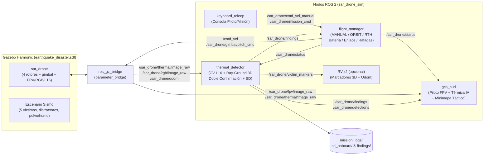

<div align="center">

# 🚁 Dron USAR Simulation

**Gemelo digital de búsqueda y rescate urbano (USAR) en ROS 2 Jazzy + Gazebo Harmonic**  
*Alineado con el ConOps (`C01–C30`) y la Matriz de Requerimientos (`R1–R37`) del Proyecto Dron USAR — Facultad de Ingeniería, UNAM*

[](https://docs.ros.org/en/jazzy/)
[](https://gazebosim.org/)
[](https://www.python.org/)
[](https://opencv.org/)
[](LICENSE)

</div>

---

## 📑 Índice

- [¿Qué hace esta simulación?](#-qué-hace-esta-simulación)
- [Arquitectura del sistema](#-arquitectura-del-sistema)
- [Trazabilidad con el ConOps (`dron-usar`)](#-trazabilidad-con-el-conops-dron-usar)
- [Requisitos e instalación](#-requisitos-e-instalación)
- [Ejecución rápida](#-ejecución-rápida)
- [Parámetros configurables (viento, peso, sensores, IA y misión)](#-parámetros-configurables-viento-peso-sensores-ia-y-misión)
- [Controles de vuelo y misión](#-controles-de-vuelo-y-misión)
- [Tópicos de ROS 2](#-tópicos-de-ros-2)
- [Registros offline y evidencias de misión](#-registros-offline-y-evidencias-de-misión)
- [Guion de demostración](#-guion-de-demostración)
- [Estructura del repositorio](#-estructura-del-repositorio)

---

## 🎯 ¿Qué hace esta simulación?

Esta simulación reproduce de principio a fin la operación de una **brigada USAR de dos operadores** (Piloto FPV + Observador Térmico) desplegando un cuadricóptero compacto sobre una zona urbana afectada por un sismo:

- **Escenario urbano post-terremoto realista**: Cuatro sectores de estructuras colapsadas con distintos patrones (*losa inclinada*, *vacío de supervivencia*, *pancake* y *muros colapsados*), helipuerto con conos perimetrales, **Puesto de Comando USAR**, cables aéreos caídos y **plumas de polvo y humo** que reducen la visibilidad RGB mientras la cámara térmica mantiene la detección.
- **Dron cuadricóptero con carga útil biespectral**: Incorpora protectores de hélice octogonales, luces de navegación/baliza, **cámara FPV fija** para el piloto y un **gimbal motorizado** (`0°–80°`) con cámara térmica radiométrica de 16 bits (`L16`) y cámara RGB co-ubicada.
- **Detección térmica asistida y filtro de distractores**: Segmenta firmas corporales humanas (`32.5–41.5 °C`) sobre 5 víctimas en postura tendida y sentada, descartando distractores realistas como un vehículo volcado con motor tibio (`~28 °C`) y un foco de incendio (`~75 °C`).
- **Geolocalización 3D y doble confirmación angular**: Proyecta cada detección térmica desde píxeles de imagen al suelo 3D `(X, Y, Z)` y a coordenadas geográficas **WGS84** (referenciadas a Ciudad Universitaria, UNAM), rastrea el ángulo de observación `Δθ` y exige confirmar desde un segundo ángulo (`≥ 35°`), ya sea volando manualmente o activando la **órbita asistida 360°**.
- **Estación Terrestre Dual (GCS HUD)**: Consola táctica en tiempo real de tres paneles (o dos ventanas independientes con `dual_windows:=true`):
  1. **Piloto FPV**: Video en vivo, horizonte artificial, brújula, velocidad, altitud, alerta de altitud mínima, ángulo de gimbal, batería y calidad de enlace.
  2. **Observador Térmico IA**: Mapa de calor con paletas intercambiables (`INFERNO`, `WHITE-HOT`, `TURBO`), recuadro PiP de cámara RGB, cajas por estado (`SOSPECHA` / `2do ANG OK` / `CONFIRMADA`) y tabla de candidatos.
  3. **Minimapa Táctico USAR**: Sectores por patrón de colapso, Puesto de Comando, perímetro seguro, trayectoria, cono FOV, pines de víctimas y bitácora de misión.
- **Failsafe autónomo y continuidad operativa**: Regreso Automático a Casa (**RTH**: ascenso seguro → retorno → descenso al helipuerto) ante pérdida de enlace, batería crítica (`< 15%`) o comando manual; simulación de **relevo de baterías en helipuerto** (`Bat #1, #2...`); perturbación de **ráfagas de viento**; respaldo continuo en **SD a bordo** y cola de envío offline hacia el Puesto de Comando.

---

## 🏗️ Arquitectura del sistema



---

## 📋 Trazabilidad con el ConOps (`dron-usar`)

| Código ConOps | Requisito / Capacidad | Implementación en `sar_drone_sim` |
| :--- | :--- | :--- |
| `C01`, `C03`, `C06` | Cuadricóptero VTOL compacto | `models/sar_drone/model.sdf` con `MulticopterVelocityControl` |
| `C02`, `C08` | Cámara térmica + segunda pantalla observador | Sensor `L16` + `thermal_detector` + panel Observador en `gcs_hud` |
| `C05` | Altura mínima y modos de seguridad con ráfagas | Alerta de altitud baja (`< 2.2 m`) y ráfaga lateral (`G`) en `flight_manager` |
| `C07` | Video FPV dedicado para el piloto | Sensor `fpv_camera` independiente + panel Piloto FPV con horizonte artificial |
| `C09`, `R4`, `R8` | Captura térmica geoetiquetada offline | Proyección rayo-suelo a `(X, Y)` + WGS84 (CU UNAM) y guardado en `mission_logs/` |
| `C10` | Grabación a bordo (SD) | Respaldo automático continuo en `mission_logs/<sesión>/sd_onboard/` |
| `C11`, `R10` | Regreso automático de seguridad (RTH) | Secuencia autónoma `CLIMB → RETURN → DESCEND` por tecla `H`, enlace perdido o batería `< 15%` |
| `C12`, `C14` | Protectores de hélice y luces de posición | Aros protectores octogonales + LEDs de navegación y baliza estroboscópica en `model.sdf` |
| `C13`, `C21` | Baterías intercambiables / operación continua | Modelo de descarga + relevo rápido en helipuerto (`B`) con contador `Bat #N` |
| `C16`, `R3`, `R18` | Detección asistida en tierra y filtro de distractores | Segmentación `32.5–41.5 °C` vs foco `~75 °C` y auto `~28 °C`, paletas `INFERNO/WHITE-HOT/TURBO` |
| `C18`, `R5` | Confirmación desde dos ángulos | Tracking angular `Δθ ≥ 35°` + órbita asistida (`O`) + validación (`C`) |
| `C19`, `C20` | Patrones de colapso y operación desde perímetro | Minimapa táctico con sectores etiquetados, Puesto de Comando y perímetro seguro |
| `C23`, `R20` | Registro local sin internet y envío al PC | Cola de envío al Puesto de Comando que sincroniza automáticamente al recuperar enlace |
| `C24` | Enlaces redundantes | Estados `PRIMARY` / `BACKUP` / `LOST` por RSSI o falla simulada (`L`) |

---

## ⚙️ Requisitos e instalación

- **SO**: Ubuntu 24.04 LTS
- **ROS 2**: Jazzy Jalisco (`colcon`, `ros-jazzy-ros-gz`, `ros-jazzy-ros-gz-bridge`, `ros-jazzy-ros-gz-sim`, `ros-jazzy-cv-bridge`, `ros-jazzy-visualization-msgs`)
- **Simulador**: Gazebo Harmonic (`gz-sim8`)
- **Python 3.12**: `python3-opencv`, `python3-numpy`

```bash
cd ~/usar_drone_ws
source /opt/ros/jazzy/setup.bash
colcon build --symlink-install
```

---

## 🚀 Ejecución rápida

### Terminal 1 — Simulación y Estación Terrestre (GCS)

```bash
source /opt/ros/jazzy/setup.bash
source ~/usar_drone_ws/install/setup.bash
ros2 launch sar_drone_sim sim.launch.py
```

Ejemplos de combinaciones útiles:

```bash
# Modo 2 pantallas separadas (Piloto FPV + Observador Térmico/Mapa)
ros2 launch sar_drone_sim sim.launch.py dual_windows:=true

# Con vista 3D en RViz2 y descarga rápida de batería para demostración
ros2 launch sar_drone_sim sim.launch.py rviz:=true battery_drain_scale:=4.0

# Modo servidor sin ventanas (ideal para CI, pruebas automatizadas o grabación de tópicos)
ros2 launch sar_drone_sim sim.launch.py headless:=true show_window:=false
```

### Terminal 2 — Control por teclado y consola de misión

```bash
source /opt/ros/jazzy/setup.bash
source ~/usar_drone_ws/install/setup.bash
ros2 run sar_drone_sim keyboard_teleop
```

---

## 🔧 Parámetros configurables (viento, peso, sensores, IA y misión)

La simulación permite ajustar tanto parámetros en tiempo de ejecución (ROS 2) como propiedades físicas, térmicas y ambientales directamente en los archivos SDF/Python.

### 1. Argumentos de lanzamiento (`launch/sim.launch.py`)

| Argumento | Valor por defecto | Descripción |
| :--- | :--- | :--- |
| `headless` | `false` | Ejecuta Gazebo sin interfaz gráfica (`-s -r --headless-rendering`). |
| `show_window` | `true` | Abre la(s) ventana(s) OpenCV de la Estación Terrestre (`gcs_hud`). |
| `dual_windows` | `false` | Divide el HUD en dos ventanas independientes: Piloto FPV y Observador + Mapa. |
| `rviz` | `false` | Lanza RViz2 precargado con `config/usar_gcs.rviz` (trayectoria y marcadores 3D). |
| `battery_drain_scale` | `1.5` | Multiplicador de consumo de batería (`1.0` ≈ autonomía real; `4.0–10.0` para demos rápidas de RTH/relevo). |

### 2. Parámetros de nodos ROS 2 (modificables vía `--ros-args -p ...` o `sim.launch.py`)

| Nodo | Parámetro | Por defecto | Qué controla |
| :--- | :--- | :--- | :--- |
| `flight_manager` | `battery_drain_scale` | `1.5` | Velocidad de descarga de la batería en vuelo/hover. |
| `flight_manager` | `rth_altitude_m` | `7.5` m | Altitud de seguridad a la que asciende el dron antes de regresar al helipuerto. |
| `flight_manager` | `min_safe_alt_m` | `2.2` m | Umbral inferior que dispara la alerta `ALTITUD BAJA` sobre escombros (`C05`). |
| `flight_manager` | `max_link_range_m` | `45.0` m | Alcance máximo del enlace de radio desde el Puesto de Comando (`C24`). |
| `flight_manager` | `orbit_radius_m` | `2.8` m | Radio de la órbita asistida de doble confirmación (`C18`). |
| `thermal_detector` | `min_human_temp_c` | `32.5` °C | Temperatura mínima para clasificar un contorno como firma corporal humana. |
| `thermal_detector` | `max_human_temp_c` | `41.5` °C | Temperatura máxima humana; píxeles superiores se marcan como anomalías (`>42 °C`). |
| `thermal_detector` | `min_area_px` / `max_area_px` | `60` / `45000` px | Filtro de tamaño de blob térmico para descartar ruido o superficies enormes. |
| `thermal_detector` | `confirm_angle_deg` | `35.0` ° | Separación angular mínima `Δθ` requerida para habilitar la doble confirmación (`C18`). |
| `thermal_detector` | `assoc_radius_m` | `2.2` m | Radio de asociación espacial para agrupar detecciones en un mismo track (`V-XX`). |
| `thermal_detector` | `ground_plane_z` | `0.25` m | Altura del plano de referencia usada en la proyección rayo-suelo 3D. |
| `thermal_detector` | `mission_log_dir` | `~/usar_drone_ws/mission_logs` | Carpeta donde se guardan el respaldo SD, los hallazgos y `mission_report.json`. |
| `gcs_hud` | `show_window` / `dual_windows` | `true` / `false` | Visibilidad y modo de pantalla única o dual. |

### 3. Peso, dinámica de vuelo, gimbal y sensores (`models/sar_drone/model.sdf`)

| Categoría | Elemento SDF | Valor actual | Qué efecto tiene cambiarlo |
| :--- | :--- | :--- | :--- |
| **Peso / Masa** | `base_link` → `<mass>` y `<inertia>` | `1.5` kg (`ixx=iyy=0.045`, `izz=0.080`) | Simula un dron más pesado (p. ej. con batería mayor o más carga útil). Si aumentas la masa, ajusta también `motorConstant` o `velocityGain`. |
| **Masa del gimbal** | `gimbal_link` → `<mass>` | `0.02` kg | Mantener ligero para no desplazar el centro de masa ni inducir cabeceo. |
| **Propulsión** | `MulticopterMotorModel` → `<maxRotVelocity>`, `<motorConstant>` | `1100.0` rad/s, `8.54858e-06` | Empuje máximo disponible de los 4 rotores. |
| **Controlador** | `MulticopterVelocityControl` → `<maximumLinearVelocity>`, `<maximumLinearAcceleration>` | `6 6 4` m/s, `2.5 2.5 2.5` m/s² | Límites físicos de velocidad y agilidad del cuadricóptero. |
| **Estabilidad PID** | `velocityGain`, `attitudeGain`, `angularRateGain` | `(2.7, 2.7, 2.7)`, `(2, 3, 0.15)`, `(0.4, 0.52, 0.18)` | Rigidez y amortiguación de la respuesta de vuelo ante comandos o ráfagas. |
| **Gimbal** | `gimbal_pitch_joint` (`<lower>`, `<upper>`) y `JointPositionController` (`p/i/d_gain`) | `0.0` a `1.45` rad (`0°–83°`), `p=1.5` | Rango y suavidad de inclinación de la cámara biespectral. |
| **Cámaras** | `fpv_camera`, `thermal_camera`, `rgb_camera` | FPV `640×360@20Hz`, Térmica `320×240@15Hz`, RGB `640×480@15Hz` | Resolución, campo de visión (`horizontal_fov`) y tasa de refresco (bajar FPS mejora rendimiento en CPU). |

### 4. Viento, ráfagas, clima y entorno térmico (`worlds/earthquake_disaster.sdf` y `flight_manager.py`)

- **Ráfagas de viento interactivas (listo para usar)**: Presionando `G` durante el vuelo se inyecta una ráfaga lateral amortiguada de **4.0 s** y pico de **0.9 m/s** (ajustable en `flight_manager.py`, método `_mission_cmd_cb` / `_control_loop`, variables `gust_until` y `mag`).
- **Viento constante global en Gazebo (opcional)**: El plugin `gz-sim-wind-effects-system` está instalado en el sistema; puedes añadir `<wind><linear_velocity>1.5 0.5 0</linear_velocity></wind>` y `<plugin filename="gz-sim-wind-effects-system" name="gz::sim::systems::WindEffects"/>` en `worlds/earthquake_disaster.sdf` para simular viento sostenido sobre todo el escenario.
- **Temperatura ambiente y firmas térmicas (`K`)**:
  - Atmósfera: `291.15 K` (`18 °C`) en `<atmosphere>`.
  - Suelo y edificios: `290.15–292.15 K` (`17–19 °C`).
  - Víctimas (`models/victim_lying` y `victim_sitting`): `308.15–310.15 K` (`35–37 °C`).
  - Distractores: cofre del auto `301.15 K` (`28 °C`) y foco de incendio `348.15 K` (`75 °C`).
- **Densidad de polvo y humo**: En `fire_smoke_emitter` y `rubble_dust_emitter` se pueden ajustar `<rate>`, `<particle_size>`, `<lifetime>` y `<min_velocity>/<max_velocity>`.
- **Ubicación geográfica (WGS84)**: Modificable en `<spherical_coordinates>` del SDF y en `ORIGIN_LAT` / `ORIGIN_LON` / `ORIGIN_ALT` de `sar_drone_sim/usar_common.py` (por defecto: Ciudad Universitaria, UNAM).
- **Presets de velocidad del teclado**: `SPEED_PRESETS` en `sar_drone_sim/keyboard_teleop.py` (`Lento`, `Normal`, `Rápido`).

---

## 🎮 Controles de vuelo y misión

| Tecla | Acción |
| :--- | :--- |
| `T` | Despegue suave automático (`~2.2 s`) |
| `W` / `S`, `A` / `D` | Desplazamiento horizontal (adelante/atrás, izquierda/derecha) |
| `R` / `F` o Flechas `↑` / `↓` | Ascender / Descender |
| `Q` / `E` o Flechas `←` / `→` | Rotar sobre el eje vertical (Yaw) |
| `Espacio` | Detención inmediata en *hover* |
| `1` / `2` / `3` o `+` / `-` | Cambiar modo de velocidad (`Lento` / `Normal` / `Rápido`) |
| `U` / `J` | Inclinar el gimbal biespectral arriba / abajo |
| `O` | Activar / cancelar **órbita asistida de doble confirmación (`C18`)** |
| `C` | **Confirmar hallazgo** y guardar paquete geoetiquetado + imágenes |
| `H` | Activar / cancelar **RTH autónomo (`C11`)** |
| `L` | Simular pérdida / recuperación de enlace (`C24` → grabación SD y RTH) |
| `B` | **Relevo de batería** al aterrizar en el helipuerto (`C13`) |
| `G` | Disparar **ráfaga lateral de viento** de prueba (`C05`) |
| `P` | Rotar paleta térmica del Observador (`INFERNO` / `WHITE-HOT` / `TURBO`) |
| `X` o `Ctrl+C` | Dejar dron en *hover* y salir |

---

## 📡 Tópicos de ROS 2

| Tópico | Tipo | Dirección / Productor | Descripción |
| :--- | :--- | :--- | :--- |
| `/cmd_vel` | `geometry_msgs/msg/Twist` | `flight_manager` → Gazebo | Comando final de velocidad en marco del dron. |
| `/sar_drone/cmd_vel_manual` | `geometry_msgs/msg/Twist` | `keyboard_teleop` → `flight_manager` | Comandos manuales del piloto. |
| `/sar_drone/mission_cmd` | `std_msgs/msg/String` (JSON) | `keyboard_teleop` → nodos | Comandos discretos (`takeoff`, `rth_toggle`, `orbit_toggle`, `confirm_finding`, etc.). |
| `/sar_drone/gimbal/pitch_cmd` | `std_msgs/msg/Float64` | `flight_manager` → Gazebo | Ángulo objetivo del gimbal (`0.0–1.40 rad`). |
| `/sar_drone/odom` | `nav_msgs/msg/Odometry` | Gazebo → ROS 2 | Posición y orientación 3D del dron. |
| `/sar_drone/fpv/image_raw` | `sensor_msgs/msg/Image` | Gazebo → `gcs_hud` | Video FPV dedicado del piloto. |
| `/sar_drone/thermal/image_raw` | `sensor_msgs/msg/Image` | Gazebo → `thermal_detector` / `gcs_hud` | Imagen térmica radiométrica cruda (`mono16`). |
| `/sar_drone/rgb/image_raw` | `sensor_msgs/msg/Image` | Gazebo → `thermal_detector` / `gcs_hud` | Imagen RGB co-ubicada en el gimbal. |
| `/sar_drone/status` | `std_msgs/msg/String` (JSON) | `flight_manager` | Modo, etapa RTH, batería, RSSI/enlace, gimbal y alertas. |
| `/sar_drone/detections` | `std_msgs/msg/String` (JSON) | `thermal_detector` | Detecciones instantáneas en imagen y anomalías `>42 °C`. |
| `/sar_drone/findings` | `std_msgs/msg/String` (JSON) | `thermal_detector` | Tracks geolocalizados (`V-XX`), ángulos `Δθ`, estado y cola al PC. |
| `/sar_drone/victim_detected` | `std_msgs/msg/Bool` | `thermal_detector` | Bandera de presencia humana en vista. |
| `/sar_drone/victim_markers` | `visualization_msgs/msg/MarkerArray` | `thermal_detector` → RViz2 | Marcadores 3D y etiquetas en marco `odom`. |
| `/sar_drone/gcs/image` | `sensor_msgs/msg/Image` | `gcs_hud` | Consola táctica renderizada (`1560×600`, `bgr8`). |

---

## 💾 Registros offline y evidencias de misión

Cada ejecución crea una carpeta de sesión independiente en `~/usar_drone_ws/mission_logs/` (sin requerir conexión a internet):

```text
mission_logs/mision_YYYYMMDD_HHMMSS/
├── mission_report.json         # Resumen consolidado de víctimas confirmadas y estado de envío al PC
├── sd_onboard/                 # Respaldo rotativo a bordo (PNG + JSON), activo incluso sin enlace
│   ├── sd_0001.png
│   └── sd_0001.json
└── findings/
    └── V-01/
        ├── finding.json        # Coordenadas locales + WGS84, altitud, temperatura, confianza y Δθ
        ├── thermal_annotated.png
        └── rgb_snapshot.png
```

---

## 🎬 Guion de demostración

1. **Despegue (`T`)**: Desde el helipuerto frente al Puesto de Comando USAR, avance con `W` hacia `victim_1`.
2. **Inspección biespectral (`J`)**: Incline el gimbal hacia abajo; observe a `V-01` aparecer como `SOSPECHA` en el panel térmico y en el minimapa táctico.
3. **Doble confirmación (`O` → `C`)**: Active la órbita asistida (`O`). Al superar `Δθ ≥ 35°` cambia a `2do ANG OK` y al completar el arco (o presionar `C`) se confirma y guarda evidencia completa en `mission_logs/`.
4. **Humo/polvo vs cámara térmica**: Vuele hacia `victim_3` (Edificio B, `(11.5, -6.8)`), compare el recuadro PiP RGB frente a la firma térmica y pruebe las paletas con `P`.
5. **Failsafe y relevo (`L` / `H` → `B`)**: Simule pérdida de enlace (`L`) para ver la estática FPV, el respaldo SD acelerado y el **RTH autónomo** al helipuerto. Al aterrizar, restaure enlace (`L`) y cambie batería (`B`).

---

## 📂 Estructura del repositorio

```text
usar_drone_ws/
├── README.md
└── src/sar_drone_sim/
    ├── config/
    │   ├── ros_gz_bridge.yaml      # Puente de tópicos ROS 2 ↔ Gazebo Harmonic
    │   └── usar_gcs.rviz           # Perfil 3D opcional para RViz2
    ├── launch/
    │   └── sim.launch.py           # Lanzamiento maestro con argumentos configurables
    ├── models/
    │   ├── sar_drone/model.sdf     # Cuadricóptero con prop guards, luces, FPV y gimbal
    │   ├── victim_lying/           # Modelo térmico de víctima tendida (35–37 °C)
    │   └── victim_sitting/         # Modelo térmico de víctima sentada (35–37 °C)
    ├── sar_drone_sim/
    │   ├── usar_common.py          # Geodesia CU UNAM, cuaterniones, arco angular y mapa
    │   ├── flight_manager.py       # Modos de vuelo, RTH, órbita, batería, enlace y ráfagas
    │   ├── thermal_detector.py     # CV térmico L16, geolocalización 3D, confirmación y logs
    │   ├── gcs_hud.py              # Estación Terrestre táctica de 3 paneles (o dual)
    │   └── keyboard_teleop.py      # Control manual y consola de misión
    └── worlds/
        └── earthquake_disaster.sdf # Mundo post-sismo con Puesto de Comando, cables y polvo/humo
```

---

## 📄 Licencia

Distribuido bajo la licencia **Apache 2.0**.
